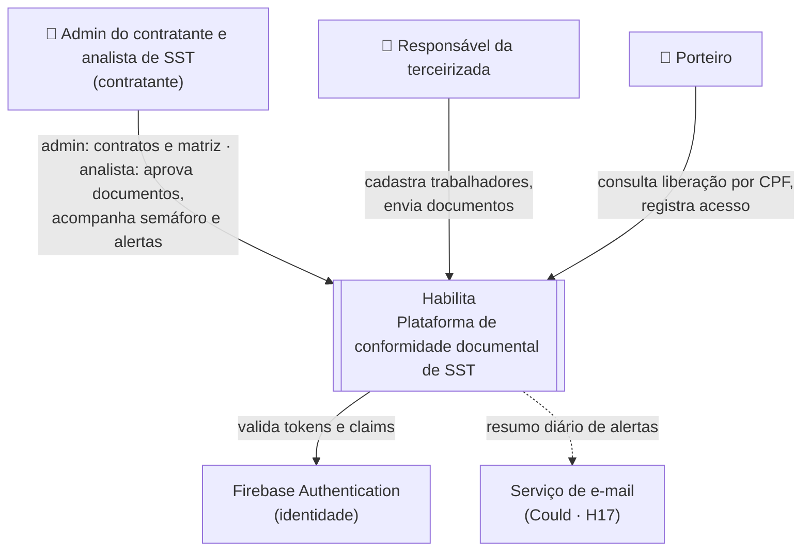
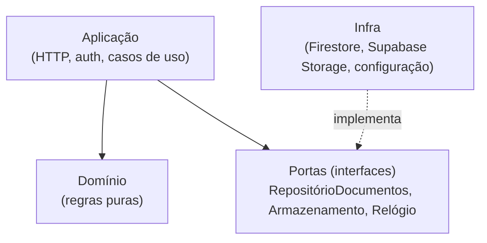
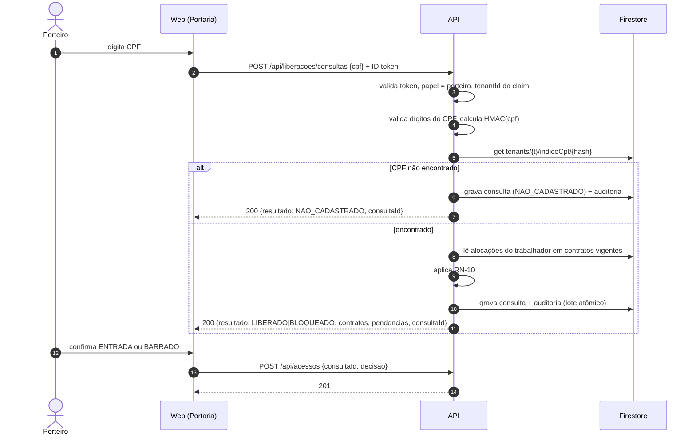
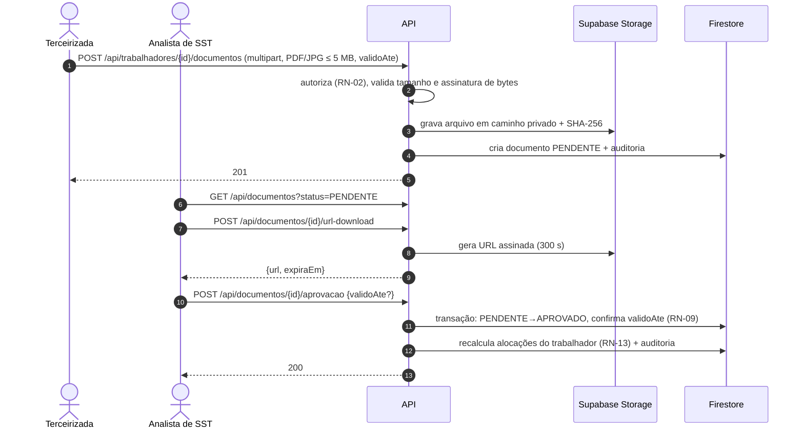
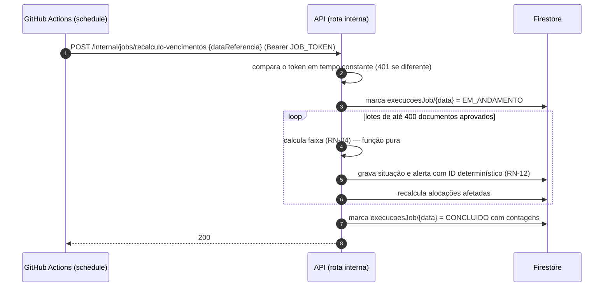

# Arquitetura

| Campo | Valor |
|---|---|
| Status | Rascunho |
| Responsável | Tech Lead |
| Última atualização | 14/10/2026 |
| Notação | Modelo C4 (níveis 1 e 2) e diagramas de sequência em Mermaid |

## 1. Objetivos e restrições que moldam a arquitetura

| Força | Consequência na arquitetura |
|---|---|
| **Isolamento entre clientes** é o principal requisito de segurança | Tenant no caminho dos dados, tenant extraído do token, acesso a dados só pelo backend ([ADR 0002](adr/0002-tenant-autorizacao.md)) |
| **Custo zero** (Plano Custo Zero, [ADR 0010](adr/0010-plano-custo-zero.md)) e uso intermitente | Só planos gratuitos sem cartão: Firebase Spark (Hosting, Auth, Firestore), Render, Supabase Storage e GitHub Actions |
| **9 semanas e equipe pequena** | Monólito modular: uma API, um frontend, um banco. Nada de microsserviços ([ADR 0005](adr/0005-estilo-arquitetural.md)) |
| **Rodar tudo localmente até a Semana 4** | Docker Compose com emuladores do Firebase (Auth, Firestore, Storage) |
| **Resposta rápida na portaria** (p95 ≤ 800 ms) | Semáforo materializado; consulta por chave (hash do CPF) |
| **Documentos com dado de saúde** (ASO) | Bucket privado, download por link temporário, nenhum dado pessoal em log ([ADR 0006](adr/0006-armazenamento-de-documentos.md)) |

## 2. Contexto (C4 nível 1)



## 3. Contêineres (C4 nível 2)

```mermaid
flowchart LR
    subgraph Navegador
        web["Web App (SPA React)<br/>3 áreas: Gestão, Terceirizada, Portaria"]
    end
    subgraph Firebase
        hosting["Firebase Hosting (Spark)<br/>estáticos da SPA"]
        auth["Firebase Auth<br/>login e custom claims"]
    end
        fs[("Firestore (Spark, us-central1)<br/>tenants/{tenantId}/…<br/>Rules: deny-all")]
    end
    subgraph Render
        api["API Habilita<br/>(web service gratuito)<br/>camadas: aplicação, domínio, infra"]
        sm["Variáveis protegidas<br/>chave HMAC, JOB_TOKEN, chaves de serviço"]
    end
    subgraph Supabase
        gcs[("Supabase Storage<br/>bucket privado<br/>sem política p/ anon")]
    end
    subgraph GitHub
        sched["Actions schedule<br/>03:00 America/Sao_Paulo"]
    end

    web -- "login (SDK)" --> auth
    web -- "carrega a SPA" --> hosting
    web -- "HTTPS (CORS restrito) + ID token" --> api
    api -- "verifica ID token (Admin SDK)" --> auth
    api -- "lê/escreve (Admin SDK)" --> fs
    api -- "grava arquivo / gera URL assinada" --> gcs
    sched -- "POST /internal/jobs/... (JOB_TOKEN)" --> api
    api -- "lê variável" --> sm
    web -. "baixa arquivo por URL assinada (5 min)" .-> gcs
```

**Regra de ouro:** o navegador **nunca** acessa Firestore ou Storage diretamente. As Security Rules do Firestore negam tudo e o bucket do Supabase não tem política para `anon`/`authenticated`; só a API, com credencial de serviço, lê e escreve. Isso concentra autorização em um único lugar testável.

## 4. Camadas da API

A API segue a arquitetura em camadas estudada no lab, com a regra de dependência apontando para o domínio.

| Camada | Responsabilidade | Exemplos no Habilita | Pode depender de |
|---|---|---|---|
| **Apresentação** (web) | Telas por papel, estados de carregando, vazio, erro e sucesso | Painel com semáforo, fila de pendentes, tela de portaria | API (via contrato OpenAPI) |
| **Aplicação** (API) | Rotas HTTP, validação de entrada, autenticação, autorização, orquestração dos casos de uso | `RejeitarDocumento`, `ConsultarLiberacao`, middleware de token/tenant/papel | Domínio, portas de infraestrutura |
| **Domínio** | Regras de negócio puras, sem I/O | Cálculo de faixa (RN-04), semáforo (RN-06), reuso (RN-08), validação de CPF/CNPJ | Nada (100% testável em unidade) |
| **Dados / Infra** | Adaptadores de Firestore, Supabase Storage, configuração (variáveis de ambiente), relógio, logger | Repositórios por tenant, gerador de URL assinada | SDKs externos |



O domínio não conhece o Firestore. Isso permite testar todas as regras com dados em memória e cumprir a meta de ≥ 80% de cobertura no domínio.

## 5. Fluxos principais

### 5.1 Consulta de liberação na portaria (J5)



### 5.2 Envio e aprovação de documento (J2 e J3)



### 5.3 Recálculo diário (J4)



Detalhes da idempotência em [ADR 0007](adr/0007-recalculo-idempotente.md).

## 6. Como a arquitetura atende os requisitos não funcionais

Os requisitos são definidos em [Requisitos Não Funcionais](../produto/requisitos/nao-funcionais.md). Esta tabela mostra **onde** cada um é atendido e **como** é verificado.

| RNF | Onde a arquitetura atende | Como verificar |
|---|---|---|
| RNF01 · Autorização por tenant e papel | Tenant no caminho, claims no token, Rules deny-all (ADR 0002) | Suíte de isolamento e matriz de autorização no CI |
| RNF02 · Upload seguro | Validação por assinatura de bytes, bucket privado, URL assinada (ADR 0006) | Testes T-UPL |
| RNF03 · Zero vulnerabilidade crítica/alta | Dependências mínimas; varredura no pipeline (ADR 0003) | Varredura de dependências, imagens e segredos |
| RNF04 · p95 leitura ≤ 800 ms / escrita ≤ 1,5 s | Semáforo materializado; consulta por chave (ADR 0007, ADR 0008) | Logs de latência por rota; k6 |
| RNF05 · Cobertura | Domínio puro, sem I/O (ADR 0005) | Relatório de cobertura em `docs/testes/relatorios` |
| RNF06 · Lighthouse ≥ 90 | SPA enxuta no Hosting com CDN | Lighthouse CI |
| RNF07 · Operação | `/healthz`, `/readyz`, logs JSON com `requestId` | Inspeção dos logs; alertas 5xx e p95 |
| RNF08 · Custo | Escala a zero, `max-instances` baixo, paginação | [FinOps](../finops/index.md) |
| RNF09 · Sem dado real em teste e demo | Seed fictício reproduzível | Revisão do seed |
| RNF10 · Disponibilidade na demo | Smoke test pós-deploy; rollback (ADR 0003) | Checklist do Demo Day |
| RNF11 · Nenhum dado pessoal em log | CPF só como HMAC; corpo da rota de portaria não registrado (ADR 0008) | Teste sobre a saída de log |
| RNF12 · Reprodutibilidade | Docker Compose + emuladores | Subida em máquina limpa por outro integrante |
| RNF13 · Portaria no celular | Tela de um campo, cor acompanhada de texto | Revisão de UI e Lighthouse |

## 7. Ambientes

| Ambiente | Quando | Composição | Dados |
|---|---|---|---|
| **Local** | S1 a S4 (e sempre para desenvolvimento) | Docker Compose: web, API, emuladores Auth/Firestore e Supabase Storage local | Seed fictício reproduzível |
| **Preview** | A partir da S5, por PR | Canal de preview do Hosting (só o frontend); o backend só roda os testes no PR | Seed fictício |
| **Produção** | A partir da S5, após merge na `main` com `ci-ok` verde | Hosting + Render + Firestore + Supabase Storage | Seed fictício para a demo |

## 8. Riscos técnicos

| Risco | Impacto | Mitigação |
|---|---|---|
| **Cold start** do Render gratuito (dorme após 15 min; cerca de 1 min para acordar) | Médio | Tela de carregamento clara; acordar a API 5 minutos antes da demo (ADR 0010); p95 medido no teste de carga local; imagem pequena e inicialização preguiçosa de SDKs |
| **Supabase local** pode divergir do Supabase em nuvem (URL assinada, limites do bucket) | Médio | Mesma versão da `storage-api` no Compose; teste de integração do adaptador; conferência no primeiro deploy (S5) |
| Consultas *collection group* sem filtro de tenant expõem dados | Alto | Restritas ao job interno; revisão de código obrigatória; teste de isolamento |
| Custo de leituras do Firestore no job diário | Baixo/Médio | Ler só documentos aprovados; lotes; volume de demo pequeno; alerta de orçamento |
| Rota síncrona (SDK `firebase-admin`) declarada como `async def` travar o servidor | Médio | Rotas com SDK síncrono declaradas com `def`; item no checklist de revisão (ADR 0001) |

## 9. Decisões pendentes

| Decisão | ADR | Prazo |
|---|---|---|
| Política de retenção de documentos | A criar | 15/11 |

## Histórico de versões

| Versão | Data | Autor | Alterações |
|---|---|---|---|
| 1.0 | 14/10/2026 | @osamuelleite | Versão inicial, conciliação PO + Tech Lead. Visão da arquitetura em camadas e diagramas de sequência, adaptados à estrutura da PO. |
| 1.1 | 03/11/2026 | @osamuelleite | Correções do CP1 (26/10) e Plano Custo Zero (ADR 0010): diagrama com Render, Supabase e GitHub Actions; CORS no lugar do rewrite; job com `JOB_TOKEN`; ambientes e riscos atualizados. |
