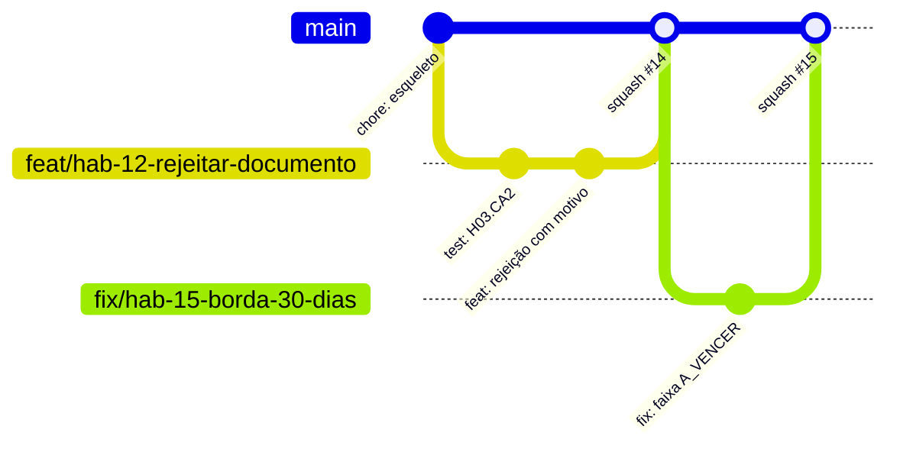
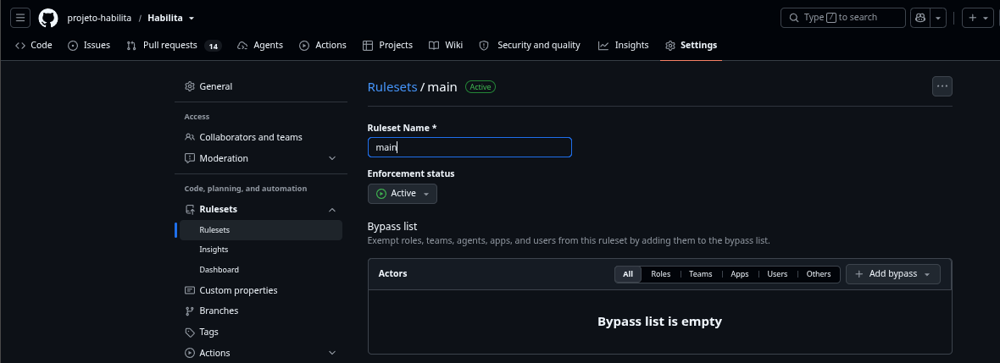
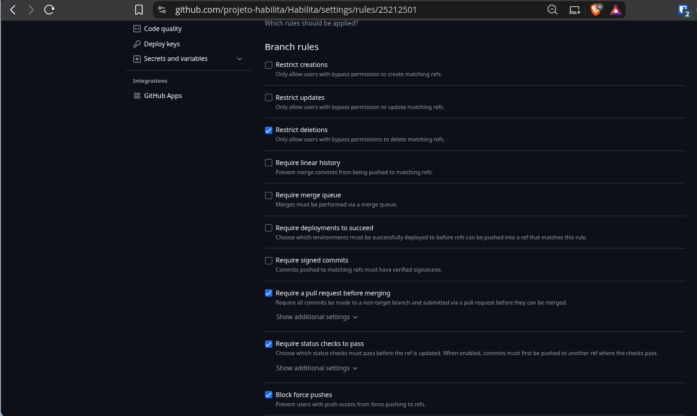
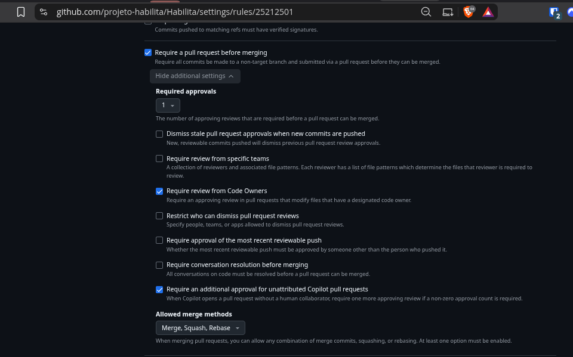
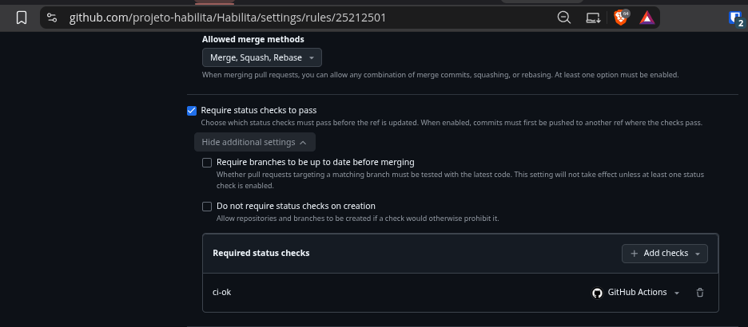
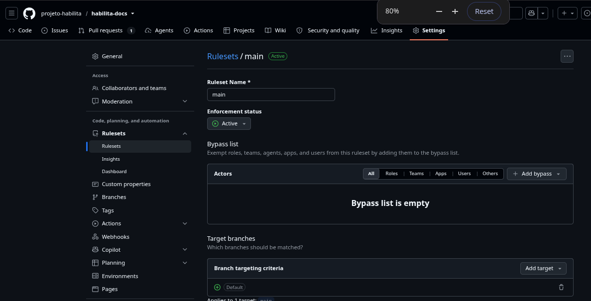
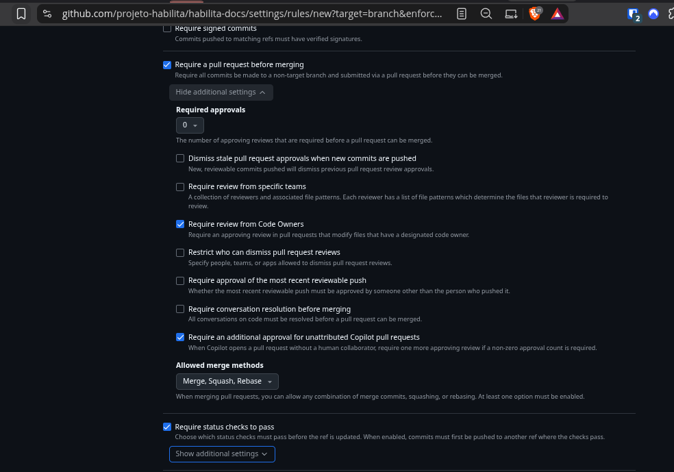

# Como contribuir

| Campo | Valor |
|---|---|
| Status | Rascunho |
| Responsável | Tech Lead (configuração no GitHub: DevOps) |
| Última atualização | 26/10/2026 |

## Regras de documentação (docs-as-code)

- Toda mudança de comportamento, contrato ou infra atualiza a página correspondente **no mesmo PR**.
- Nova decisão relevante → nova ADR em `docs/arquitetura/adr/` e entrada no `mkdocs.yml` ([ADR 0004](../arquitetura/adr/0004-documentacao-mkdocs.md)).
- Página nova = arquivo `.md` **e** linha no `nav:` do `mkdocs.yml`; antes do push, `python -m mkdocs build --strict` sem erro ([Primeiros passos](primeiros-passos.md)).

## Modelo de branches: GitHub Flow

Uma branch principal (`main`), sempre implantável, e uma branch curta por história, integrada por Pull Request.



**Por que não Gitflow:** Gitflow (branches `develop`, `release` e `hotfix`) serve a produtos com versões lançadas em ciclos e várias versões em produção. O Habilita tem uma única versão em produção, deploy contínuo após merge (Caderno CP3) e preview por PR. Branches longas só atrasariam a integração e aumentariam conflitos em 9 semanas.

## Regras da `main` (proteção de branch, nos dois repositórios)

Valem para [projeto-habilita/habilita-docs](https://github.com/projeto-habilita/habilita-docs) e para [projeto-habilita/Habilita](https://github.com/projeto-habilita/Habilita). Passo a passo e prints em [Configuração do GitHub](configuracao-github.md).

- [ ] Push direto bloqueado para todos, **inclusive administradores** (sem bypass).
- [ ] Merge só por PR com **2 aprovações** de pessoas diferentes do autor, incluindo um dono do CODEOWNERS.
- [ ] Aprovação anulada quando há novo commit; o último push precisa ser aprovado por outra pessoa.
- [ ] Check obrigatório verde: **`ci-ok`** no código (lint, build, testes, compose) e **`build`** nos docs (`mkdocs build --strict`).
- [ ] Branch atualizada com a `main` antes do merge.
- [ ] Merge por **squash** (um commit por história na `main`).
- [ ] Conversas do PR resolvidas antes do merge.
- [ ] Branch apagada após o merge.

## Nome das branches

`<tipo>/hab-<NN>-<descricao-curta>`

| Tipo | Uso | Exemplo |
|---|---|---|
| `feat` | Nova funcionalidade | `feat/hab-12-rejeitar-documento` |
| `fix` | Correção de defeito | `fix/hab-15-borda-30-dias` |
| `docs` | Só documentação | `docs/adr-0006-armazenamento` |
| `test` | Só testes | `test/hab-20-isolamento-tenant` |
| `chore` | Configuração, dependências, CI | `chore/ci-lint-build` |
| `refactor` | Mudança sem alterar comportamento | `refactor/hab-14-funcao-pura-faixa` |

## Commits: Conventional Commits

```
<tipo>(<escopo>): <resumo no imperativo, até 72 caracteres>

[corpo opcional: o porquê da mudança]

Refs: H03
```

- **Tipos:** `feat`, `fix`, `docs`, `test`, `refactor`, `chore`, `ci`, `perf`, `build`.
- **Escopos sugeridos:** `web`, `api`, `dominio`, `infra`, `docs`, `seed`.
- Exemplos:
  - `feat(api): rejeitar documento exigindo motivo`
  - `test(dominio): cobrir bordas D+29, D+30 e D+31`
  - `docs(adr): registrar decisão de armazenamento`
- Mudança incompatível de contrato: `feat(api)!: ...` e explicação no corpo.

## Pull Requests

- Um PR por história (ou parte dela, se for grande). Ideal: até ~400 linhas alteradas.
- Título no padrão Conventional Commits (vira o commit do squash).
- Template obrigatório: ``.github/PULL_REQUEST_TEMPLATE.md``.
- Revisor responde em até 1 dia útil. PR parado há mais de 2 dias vai para a reunião semanal.
- Rascunho (*draft*) é incentivado para receber feedback cedo.

## CODEOWNERS (Checkpoint 1)

Arquivo `.github/CODEOWNERS` com usuários reais do GitHub da equipe. Modelo (substituir pelos usuários):

```
# Padrão: Tech Lead revisa o que não tiver dono específico
*                          @usuario-tech-lead

# Frontend
/apps/web/                 @usuario-frontend

# Backend e domínio
/apps/api/                 @usuario-backend @usuario-tech-lead

# Contrato da API: frontend e backend precisam concordar
/openapi.yaml              @usuario-backend @usuario-frontend

# Decisões de arquitetura e segurança
/docs/arquitetura/         @usuario-tech-lead
/docs/seguranca/           @usuario-tech-lead

# Produto
/docs/produto/             @usuario-po

# Infra e pipeline
/.github/                  @usuario-devops
/mkdocs.yml                @usuario-po @usuario-tech-lead
/docker-compose.yml        @usuario-devops
```

## Evidências da proteção da main (Checkpoint 2, DO-07)

Registro das evidências de proteção da branch `main` em 31/10/2026, pelo DevOps (@pedrolmelo), para conferência do item DO-07 do Checkpoint 2.

### Repositório da aplicação (`projeto-habilita/Habilita`)

| O que a imagem prova | Arquivo |
|---|---|
| Ruleset `main` com status ativo (`Active`) e lista de bypass vazia (`Bypass list is empty`). | <br>_Figura 1: Ruleset da aplicação ativo sem exceções de bypass._ |
| Regras ativas na branch `main`: restrição de exclusão (`Restrict deletions`), PR obrigatório (`Require a pull request before merging`), checagens obrigatórias (`Require status checks to pass`) e bloqueio de force push (`Block force pushes`). | <br>_Figura 2: Conjunto de regras de branch habilitadas para a main._ |
| Exigência de 1 aprovação em PR (`Required approvals: 1`) e revisão obrigatória por Code Owners (`Require review from Code Owners`). | <br>_Figura 3: Configuração de aprovação e Code Owners do repositório de aplicação._ |
| Verificação obrigatória de status configurada com o check `ci-ok` do GitHub Actions. | <br>_Figura 4: Status check ci-ok obrigatório para merge na main._ |

### Repositório de documentação (`projeto-habilita/habilita-docs`)

| O que a imagem prova | Arquivo |
|---|---|
| Ruleset `main` ativo (`Active`), lista de bypass vazia e aplicação direcionada à branch padrão `main`. | <br>_Figura 5: Ruleset da documentação ativo e sem exceções de bypass._ |
| Configuração de regra em tela de novo ruleset (`/rules/new`), com `Require review from Code Owners` selecionado, porém com 0 aprovações (`Required approvals: 0`). | <br>_Figura 6: Tela de configuração de regra para o repositório de documentação._ |

### Conferência com as regras da seção "Regras da main"

| Regra | Repositório da aplicação (`Habilita`) | Repositório de docs (`habilita-docs`) |
|---|---|---|
| **Push direto bloqueado para todos, inclusive administradores** | **Atende** — Ruleset ativo, bypass list vazia e PR obrigatório (`app-01`, `app-02`). | **Atende** — Ruleset ativo e bypass list vazia (`docs-01`). |
| **Merge só por PR com 1 aprovação de alguém diferente do autor** | **Atende** — Exige PR com 1 aprovação obrigatória e Code Owners (`app-03`). | **Não atende (aprovação em 0)** — Imagem `docs-02` mostra `Required approvals: 0` em formulário `/rules/new`. |
| **Aprovação anulada quando há novo commit** | **Não atende** — Opção "Dismiss stale pull request approvals when new commits are pushed" está desmarcada (`app-03`). | **Não atende** — Opção "Dismiss stale pull request approvals when new commits are pushed" está desmarcada (`docs-02`). |
| **CI obrigatório verde (lint, build e `mkdocs build --strict` no CP1; testes a partir do CP2)** | **Atende** — Status check obrigatório `ci-ok` ativo via GitHub Actions (`app-04`). | **Não comprovado (imagem de regra ainda não salva)** — "Require status checks to pass" está marcado em `docs-02`, mas configurações adicionais estão recolhidas e tela é de formulário `/rules/new`; não há print salva de checks específicos. |
| **Branch atualizada com a `main` antes do merge** | **Não atende** — Opção "Require branches to be up to date before merging" está desmarcada (`app-04`). | **Não comprovado pelas imagens** — Opção de checks está recolhida na imagem `docs-02`. |
| **Merge por squash (um commit por história na `main`)** | **Não atende** — "Allowed merge methods" permite `Merge, Squash, Rebase` (`app-03`), sem restrição exclusiva a Squash. | **Não atende** — "Allowed merge methods" permite `Merge, Squash, Rebase` (`docs-02`). |
| **Conversas do PR resolvidas antes do merge** | **Não atende** — Opção "Require conversation resolution before merging" está desmarcada (`app-03`). | **Não atende** — Opção "Require conversation resolution before merging" está desmarcada (`docs-02`). |
| **Branch apagada após o merge** | **Não comprovado pelas imagens** — Configuração geral de repositório, não visível nas telas de branch ruleset. | **Não comprovado pelas imagens** — Configuração geral de repositório, não visível nas telas de branch ruleset. |

### Diferenças em relação à página

A conferência visual das telas do GitHub revela que o núcleo essencial de segurança (bloqueio de push direto para todos, lista de bypass vazia, obrigatoriedade de PR e checagem de CI na aplicação) está devidamente implementado. No entanto, algumas salvaguardas estritas descritas no início desta página ainda não estão marcadas nos rulesets: anulação de aprovações antigas após novo push, obrigatoriedade de branch atualizada antes do merge, restrição estrita para permitir unicamente merge por Squash, e exigência de resolução de conversas. Além disso, no repositório `habilita-docs`, a captura disponível reflete uma tela de criação de regra (`/rules/new`) com 0 aprovações obrigatórias configuradas.

A decisão de ativar essas travas estritas no GitHub ou de ajustar o texto da documentação é de competência do Tech Lead (@osamuelleite).

## Versões e tags

- Cada gate recebe uma tag anotada na `main`: `cp1-fundacao`, `cp2-nucleo`, `cp3-nuvem`, `cp4-estabilizacao`, `v1.0.0-demo-day`.
- Imagens de contêiner usam o SHA do commit como tag; nunca `latest` em produção.

## Histórico de versões

| Versão | Data | Autor | Alterações |
|---|---|---|---|
| 1.0 | 14/10/2026 | @osamuelleite | Versão inicial, conciliação PO + Tech Lead. Fluxo Git, branches, PR e proteção da main. |
| 1.1 | 31/10/2026 | @pedrolmelo | Registro das evidências de proteção da main para o Checkpoint 2 (DO-07) e conferência com as regras da equipe. |
| 1.2 | 03/11/2026 | @osamuelleite | Proteção da `main` com 2 aprovações, CODEOWNERS e checks `ci-ok`/`build`, nos dois repositórios da org `projeto-habilita`. |
