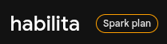
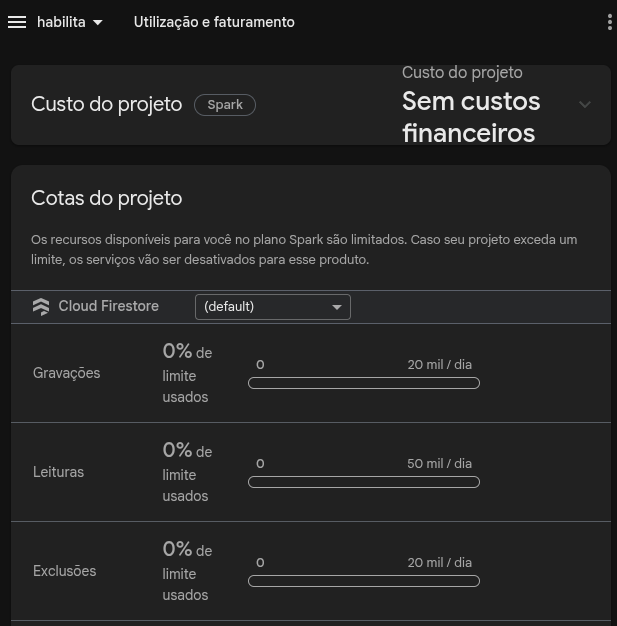
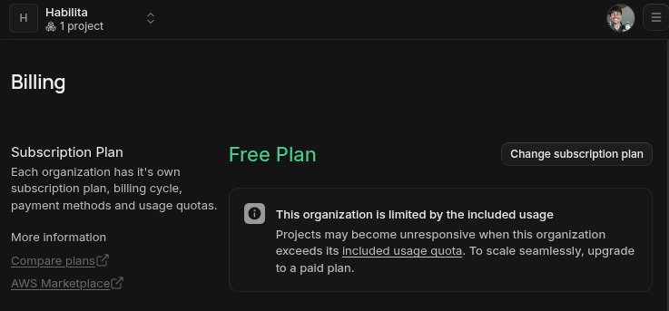
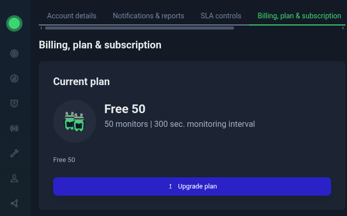

# Registro de gasto — Checkpoints 2 e 3

| Campo | Valor |
|---|---|
| Status | Conforme (US$ 0,00 acumulado) |
| Data da declaração | 31/10/2026 (CP2) · atualizada em 15/11/2026 (CP3) |
| Responsável | @pedrolmelo (DevOps) |
| Aprovação | Tech Lead (@osamuelleite) |
| Relacionados | [FinOps](index.md), [Cotas dos planos gratuitos](cotas-gratuitas.md), [ADR 0010](../arquitetura/adr/0010-plano-custo-zero.md) |

## Declaração de gasto (Checkpoint 2 — 31/10/2026)

Em conformidade com as diretrizes do **Plano Custo Zero** ([ADR 0010](../arquitetura/adr/0010-plano-custo-zero.md)) e os requisitos do Checkpoint 2 (01/11/2026), o DevOps (@pedrolmelo) declara que:

> O gasto acumulado da plataforma Habilita em **31/10/2026** é de estritamente **US$ 0,00**, operando exclusivamente no plano **Spark** do projeto Firebase `habilita`, sem conta de faturamento vinculada e sem qualquer cartão de crédito cadastrado em nenhum serviço da infraestrutura.

## Checkpoint 3 (15/11/2026)

Em **15/11/2026**, para o Checkpoint 3, o gasto acumulado da plataforma Habilita permanece em estritamente **US$ 0,00**. Nenhum cartão de crédito ou conta de faturamento foi cadastrado em nenhum provedor.

> **Débito técnico registrado no Checkpoint 3 (API pública):** a publicação da API FastAPI em nuvem não foi realizada neste gate porque tanto o **Render** (mesmo na criação de serviço no plano Free) quanto o **Hugging Face Spaces** (Docker) exigiram cadastro de cartão de crédito ou assinatura paga na conta da equipe. Em cumprimento estrito à Regra de Ouro nº 1 do Plano Custo Zero ([ADR 0010 §3.1](../arquitetura/adr/0010-plano-custo-zero.md): *"Nunca cadastrar cartão em nenhum serviço"*), a API não foi ativada nessas plataformas. O frontend está configurado no Firebase Hosting (`habilita-eb7ca`), o banco e autenticação operam no plano Spark, o armazenamento em nuvem foi criado no plano Free do Supabase e a demonstração oficial ponta a ponta do CP3 ocorre localmente via `docker compose up` ([ADR 0011, D5](../arquitetura/adr/0011-divergencias-caderno.md)).

### Serviços do Checkpoint 3

| Serviço | Provedor | Plano | Estado no CP3 (15/11/2026) | Gasto acumulado |
|---|---|---|---|---|
| **Firebase Auth, Firestore, Hosting** | Google Firebase | Spark (Gratuito) | Ativo no projeto `habilita-eb7ca` (`https://habilita-eb7ca.web.app` e `https://habilita-eb7ca.firebaseapp.com`), sem faturamento vinculado | US$ 0,00 |
| **Supabase Storage (Arquivos)** | Supabase | Free Plan (1 GB) | Ativo na organização `Habilita` com bucket privado, sem método de pagamento | US$ 0,00 |
| **GitHub Actions e Pages** | GitHub | Free | Ativo (CI `ci-ok`, deploy do Hosting `deploy-web.yml`, agendamento `job-diario.yml` e documentação) | US$ 0,00 |
| **UptimeRobot (Monitoramento)** | UptimeRobot | Free 50 (50 monitores, 5 min) | Conta ativa no plano gratuito sem cartão; monitor HTTP configurado após o primeiro deploy da `main` no Hosting | US$ 0,00 |
| **API pública (Render / HF Spaces)** | — | — | **Não ativado (débito técnico do CP3):** provedores exigiram cartão de crédito/plano pago; demo ponta a ponta executada via `docker compose up` local | US$ 0,00 |

## Tabela de evidências

| Arquivo | O que prova | Data | Responsável | Estado |
|---|---|---|---|---|
| `evidencias/spark-plano.png` | Console do Firebase exibindo o selo do plano gratuito Spark ("Spark plan"). | 31/10/2026 | @pedrolmelo | **Existe** |
| `evidencias/firebase-plano.png` | Aba "Utilização e faturamento" do Firebase mostrando "Custo do projeto Spark: Sem custos financeiros" e cotas diárias do Cloud Firestore em 0%. | 15/11/2026 | @pedrolmelo | **Existe** |
| `evidencias/supabase-plano.png` | Painel de faturamento (*Billing*) da organização `Habilita` no Supabase comprovando assinatura no **Free Plan** limitada à cota gratuita incluída. | 15/11/2026 | @pedrolmelo | **Existe** |
| `evidencias/uptimerobot-plano.png` | Aba *Billing, plan & subscription* do UptimeRobot comprovando operação no plano **Free 50** (50 monitores, intervalo de 300 s) sem faturamento. | 15/11/2026 | @pedrolmelo | **Existe** |
| `evidencias/render-plano.png` | Workspace do Render sem cartão de crédito. | — | @pedrolmelo | **Não aplicável (débito do CP3):** Render exigiu cartão de crédito no cadastro do serviço gratuito e não foi ativado |

### Evidências do plano Firebase Spark (CP2 e CP3)

*Figura 1: Captura do console do Firebase evidenciando o selo Spark plan (CP2).*

*Figura 2: Tela "Utilização e faturamento" do Firebase comprovando "Sem custos financeiros" no plano Spark e consumo de cotas dentro do limite gratuito (CP3).*

### Evidência do plano Supabase Free (CP3)

*Figura 3: Painel de Billing da organização Habilita no Supabase operando no Free Plan sem método de pagamento (CP3).*

### Evidência do plano UptimeRobot Free (CP3)

*Figura 4: Painel Billing, plan & subscription do UptimeRobot operando no plano Free 50 (CP3).*

## Como outra pessoa confere

Para reproduzir a verificação de custo zero de forma independente:

1. Acessar o [Console do Firebase](https://console.firebase.google.com/) com uma conta membro do projeto `habilita-eb7ca`.
2. No menu lateral esquerdo inferior, ou acessando o ícone de engrenagem (**Configurações do projeto**) → aba **Utilização e faturamento**.
3. Confirmar que o plano ativo exibido é o **Spark** ("Sem custos financeiros").
4. No painel do **Supabase** (organização `Habilita` → *Organization Settings → Billing*), confirmar que o *Subscription Plan* exibido é **Free Plan**.
5. No painel do **UptimeRobot** (*Account settings → Billing, plan & subscription*), confirmar que o *Current plan* é **Free 50**.

## Se algum dia o gasto deixar de ser zero

Caso ocorra qualquer cobrança ou desvio inesperado que resulte em gasto superior a zero (substituindo o campo "motivo e contenção" do checklist do Caderno):

1. **Registro imediato:** o responsável deve documentar imediatamente a data, o serviço originador e o montante financeiro incorrido.
2. **Identificação da causa raiz:** apurar se houve clique acidental em upgrade de plano, provisionamento fora do tier gratuito ou vazamento de chave.
3. **Ação de contenção imediata:** desligar ou rebaixar imediatamente o recurso gerador de custo para a modalidade gratuita no mesmo instante.
4. **Comunicação:** notificar no mesmo dia o Tech Lead (@osamuelleite) e os tutores do AI Lab / Makers sobre a ocorrência e as medidas tomadas.
5. **Auditoria:** registrar o incidente no relatório semanal de FinOps com a devida ação corretiva para evitar reincidência.

## Histórico de versões

| Versão | Data | Autor | Alterações |
|---|---|---|---|
| 1.0 | 31/10/2026 | @pedrolmelo | Versão inicial: registro de gasto US$ 0,00 no Checkpoint 2, declaração do DevOps e evidência do plano Spark. |
| 1.1 | 15/11/2026 | @pedrolmelo | Seção do Checkpoint 3 com gasto US$ 0,00, evidências do Firebase Spark (`firebase-plano.png`), Supabase Free (`supabase-plano.png`) e UptimeRobot Free (`uptimerobot-plano.png`), e registro do débito técnico da API pública por exigência de cartão no Render/HF Spaces. |
