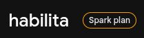

# Registro de gasto — Checkpoint 2

| Campo | Valor |
|---|---|
| Status | Conforme (US$ 0,00 acumulado) |
| Data da declaração | 31/10/2026 |
| Responsável | @pedrolmelo (DevOps) |
| Aprovação | Tech Lead (@osamuelleite) |
| Relacionados | [FinOps](index.md), [ADR 0010](../arquitetura/adr/0010-plano-custo-zero.md) |

## Declaração de gasto

Em conformidade com as diretrizes do **Plano Custo Zero** ([ADR 0010](../arquitetura/adr/0010-plano-custo-zero.md)) e os requisitos do Checkpoint 2 (01/11/2026), o DevOps (@pedrolmelo) declara que:

> O gasto acumulado da plataforma Habilita em **31/10/2026** é de estritamente **US$ 0,00**, operando exclusivamente no plano **Spark** do projeto Firebase `habilita`, sem conta de faturamento vinculada e sem qualquer cartão de crédito cadastrado em nenhum serviço da infraestrutura.

## Serviços em uso

| Serviço | Provedor | Plano | Estado | Gasto acumulado |
|---|---|---|---|---|
| **Firebase Auth, Firestore, Hosting** | Google Firebase | Spark (Gratuito) | Ativo (desenvolvimento e preview de web) | US$ 0,00 |
| **GitHub Actions e Pages** | GitHub | Free | Ativo (CI/CD e documentação) | US$ 0,00 |
| **Render (API)** | Render | Free | Ainda não criado (previsto para o CP3) | US$ 0,00 |
| **Supabase Storage (Arquivos)** | Supabase | Free | Ainda não criado (previsto para o CP3) | US$ 0,00 |
| **UptimeRobot (Monitoramento)** | UptimeRobot | Free | Ainda não criado (previsto para o CP3) | US$ 0,00 |

## Tabela de evidências

| Arquivo | O que prova | Data | Responsável | Estado |
|---|---|---|---|---|
| `evidencias/spark-plano.png` | Console do Firebase exibindo o projeto `habilita` no plano gratuito Spark ("Spark plan"), com botão para upgrade ativo e sem conta de faturamento vinculada. | 31/10/2026 | @pedrolmelo | **Existe** |
| `evidencias/render-plano.png` | Workspace do Render no plano gratuito sem cartão de crédito cadastrado. | — | @pedrolmelo | **Pendente** (serviço previsto para o CP3) |
| `evidencias/supabase-plano.png` | Organização do Supabase no plano Free sem método de pagamento. | — | @pedrolmelo | **Pendente** (serviço previsto para o CP3) |
| `evidencias/uptimerobot-plano.png` | Conta do UptimeRobot no plano gratuito de 50 monitores sem faturamento. | — | @pedrolmelo | **Pendente** (serviço previsto para o CP3) |

### Evidência do plano Firebase Spark

*Figura 1: Captura do console do Firebase evidenciando o projeto habilita operando no Spark plan.*

*(Nota: para os serviços que ainda não foram criados em nuvem — Render, Supabase de produção e UptimeRobot —, as respectivas prints comprobatórias de plano gratuito e ausência de forma de pagamento serão anexadas durante o Checkpoint 3, no momento do provisionamento).*

## Como outra pessoa confere

Para reproduzir a verificação de custo zero de forma independente:

1. Acessar o [Console do Firebase](https://console.firebase.google.com/) com uma conta membro do projeto `habilita`.
2. No menu lateral esquerdo inferior, ou acessando o ícone de engrenagem ⚙️ (**Configurações do projeto**) → aba **Uso e faturamento**.
3. Confirmar que o plano ativo exibido é o **Spark** (identificado pelo selo "Spark plan").
4. Constatar a presença do botão "Fazer upgrade" (ou "Upgrade"), o que comprova que o projeto não foi migrado para o plano Blaze e não possui conta de faturamento do Google Cloud atrelada.
5. Verificar que a fatura atual e o valor a pagar registram **US$ 0,00**.

## Se algum dia o gasto deixar de ser zero

Caso ocorra qualquer cobrança ou desvio inesperado que resulte em gasto superior a zero (substituindo o campo "motivo e contenção" do checklist do Caderno):

1. **Registro imediato:** o responsável deve documentar imediatamente a data, o serviço originador e o montante financeiro incorrido.
2. **Identificação da causa raiz:** apurar se houve clique acidental em upgrade de plano, provisionamento fora do tier gratuito ou vazamento de chave.
3. **Ação de contenção imediata:** desligar ou rebaixar imediatamente o recurso gerador de custo para a modalidade gratuita no mesmo instante.
4. **Comunicação:** notificar no mesmo dia o Tech Lead (@osamuelleite) e os tutores do AI Lab / Makers sobre a ocorrência e as medidas tomadas.
5. **Auditoria:** registrar o incidente no relatório semanal de FinOps com a devida ação corretiva para evitar reincidência.

## Histórico de versões

| Versão | Data | Autor | Alterações |
|---|---|---|---|
| 1.0 | 31/10/2026 | @pedrolmelo | Versão inicial: registro de gasto US$ 0,00 no Checkpoint 2, declaração do DevOps e evidência do plano Spark. |
