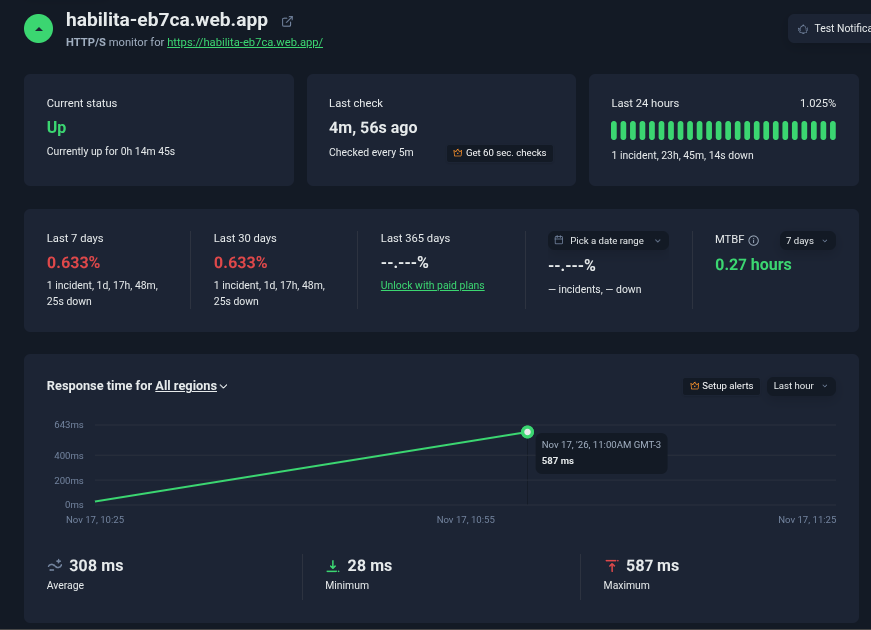

# Operação (Runbook)

| Campo | Valor |
|---|---|
| Status | Ativo (Checkpoint 3 — versão Plano Custo Zero) |
| Responsável | @pedrolmelo (DevOps) e @osamuelleite (Tech Lead) |
| Última atualização | 15/11/2026 |
| Relacionados | [ADR 0003](../arquitetura/adr/0003-ci-cd.md), [ADR 0007](../arquitetura/adr/0007-recalculo-idempotente.md), [ADR 0010](../arquitetura/adr/0010-plano-custo-zero.md), [FinOps](../finops/index.md), [Cotas gratuitas](../finops/cotas-gratuitas.md) |

## 1. Estado operacional no Checkpoint 3

Este runbook descreve apenas os procedimentos operacionais que **existem de fato** no repositório até o Checkpoint 3 (15/11/2026) e sinaliza explicitamente o que permanece **pendente** para o Checkpoint 4.

| Componente | Estado no CP3 | Onde roda / URL |
|---|---|---|
| **Frontend (SPA React + Vite)** | **Ativo** (workflow `.github/workflows/deploy-web.yml` e `firebase.json`) | Firebase Hosting (plano Spark, projeto `habilita-eb7ca`): `https://habilita-eb7ca.web.app` e `https://habilita-eb7ca.firebaseapp.com`, além de canais de preview por PR (`expires: 7d`) |
| **Banco de dados e Autenticação** | **Ativo** | Cloud Firestore (`us-central1`, regras `deny-all`) e Firebase Authentication no projeto `habilita-eb7ca` (plano Spark) |
| **Armazenamento de documentos** | **Ativo** (bucket criado em nuvem; emulador/serviço local no Compose) | Supabase Storage (plano Free, 1 GB, bucket privado sem políticas para `anon`/`authenticated`) |
| **Job diário de recálculo** | **Parcial** (workflow `.github/workflows/job-diario.yml` criado; depende da rota no backend e de URL pública da API) | GitHub Actions (`cron: "0 6 * * *"` = 03:00 BRT e `workflow_dispatch`) |
| **Monitoramento externo** | **Ativo** (conta Free 50 criada; monitor no Hosting após primeiro deploy da `main`) | UptimeRobot (intervalo de 5 minutos, alerta por e-mail) |
| **API FastAPI em nuvem** | **Pendente (débito técnico do CP3)** | Demonstração oficial executada localmente via `docker compose up` ([ADR 0011, D5](../arquitetura/adr/0011-divergencias-caderno.md)). O Render (mesmo no plano Free) e o Hugging Face Spaces (Docker) exigiram cartão de crédito/plano pago, vedado pela [ADR 0010](../arquitetura/adr/0010-plano-custo-zero.md); o host gratuito sem cartão será escolhido e registrado em ADR até o CP4 ([ADR 0011, D4](../arquitetura/adr/0011-divergencias-caderno.md)) |

---

## 2. Verificações de saúde (`/healthz` e `/readyz`)

- **`GET /healthz` (verificação de vida — *liveness*):**
  - **Estado:** implementado na `main` (`apps/api/src/habilita/saude/rotas.py`).
  - **Comportamento:** responde `200 OK` com `{"status": "ok"}` sem consultar Firestore ou Supabase Storage, e sem retornar dados pessoais.
  - **Como verificar localmente:**
    ```bash
    curl -sS -f http://127.0.0.1:8000/healthz
    ```
- **`GET /readyz` (verificação de prontidão — *readiness*):**
  - **Estado:** implementado inicialmente como stub no PR #32 (`{"status": "ok"}`); **pendente** a verificação real de conectividade com o Firestore (timeout curto retornando `200 OK` ou `503 Service Unavailable`) e a publicação da API em URL pública.

---

## 3. Monitoramento externo (UptimeRobot)

- **Configuração atual (CP3):**
  - Conta no plano **Free 50** (sem cartão de crédito, até 50 monitores HTTP(s) com checagem a cada 5 minutos / 300 segundos e notificação por e-mail).
  - Monitor HTTP(S) ativo acompanhando a disponibilidade do frontend publicado no Firebase Hosting (`https://habilita-eb7ca.web.app`), respondendo **Up** com checagens a cada 5 minutos.
  - Quando a API pública estiver no ar com `/readyz` consultando o Firestore, um monitor adicional apontará para `GET <API_URL>/readyz`.


*Evidência do monitor HTTP(S) ativo no UptimeRobot para `https://habilita-eb7ca.web.app/` (status Up, checagem a cada 5 min).*

---

## 4. Procedimento de Rollback

### 4.1 Rollback do Frontend no Firebase Hosting (ativo)

O workflow `.github/workflows/deploy-web.yml` publica uma nova versão no canal `live` a cada execução bem-sucedida do workflow `CI` na branch `main`. Caso uma versão publicada apresente regressão visual ou falha:

**Opção A — Rollback imediato pelo Console do Firebase (em segundos, sem novo build):**

1. Acessar o [Console do Firebase](https://console.firebase.google.com/project/habilita-eb7ca/hosting/sites) com uma conta autorizada do projeto `habilita-eb7ca`.
2. No menu lateral, abrir **Criação → Hosting** e clicar em **Ver** no domínio principal (`habilita-eb7ca.web.app`).
3. Na aba **Histórico de versões** (*Release history*), localizar a versão estável imediatamente anterior.
4. Clicar no menu de três pontos (`⋮`) à direita da versão anterior e selecionar **Fazer rollback** (*Rollback*) → confirmar.
5. Verificar imediatamente no navegador (`https://habilita-eb7ca.web.app`) que a versão anterior voltou a ser servida (o `index.html` usa `Cache-Control: no-cache`, garantindo atualização imediata).

**Opção B — Rollback via Git (reversão rastreável na `main`):**

1. Criar uma branch de reversão (`fix/hab-NN-revert-deploy-web`) com `git revert <sha-do-commit-com-defeito>`.
2. Abrir Pull Request para a `main`, aguardar o check obrigatório `ci-ok` e as 2 aprovações.
3. Após o squash merge na `main`, a conclusão do workflow `CI` acionará automaticamente o job `live` do `deploy-web.yml`, republicando a versão revertida.

### 4.2 Rollback da API em nuvem (pendente)

- **Estado:** pendente de publicação da API em provedor gratuito sem exigência de cartão. No planejamento da [ADR 0010 §3.5](../arquitetura/adr/0010-plano-custo-zero.md), o rollback da API é realizado pelo histórico dos últimos deploys no painel do provedor ou via `git revert` na `main`.

---

## 5. Execução manual do Job Diário (`workflow_dispatch`)

O workflow `.github/workflows/job-diario.yml` agenda a execução diária para `06:00 UTC` (`03:00` em `America/Sao_Paulo`, conforme [ADR 0007 §3.1](../arquitetura/adr/0007-recalculo-idempotente.md)) e permite disparo manual para testes, demonstrações ou reprocessamento (seguro por ser idempotente).

### Como disparar manualmente no GitHub

1. No repositório `projeto-habilita/Habilita`, abrir a aba **Actions**.
2. Na barra lateral esquerda, selecionar o workflow **Job Diário (Recálculo de Vencimentos)**.
3. Clicar no botão **Run workflow** (canto direito):
   - **Branch:** `main`
   - **`dataReferencia` (opcional):** informar uma data no formato `YYYY-MM-DD` (ex.: `2026-11-15`) ou deixar em branco para usar a data atual em `America/Sao_Paulo`.
4. Clicar em **Run workflow** e acompanhar o log do job `recalculo-vencimentos`.

### Comportamento atual (CP3)

- **Enquanto a variável `API_URL` não estiver configurada (débito técnico da API pública):**
  - Nas execuções agendadas (`schedule`), o workflow emite `::notice::API pública não configurada, job ignorado: débito do CP3` e encerra com código `0` (evitando falsos alertas de falha).
  - Nas execuções manuais (`workflow_dispatch`), o workflow falha cedo com `::error::` em português explicando que a variável `API_URL` precisa ser configurada.
- **Quando `API_URL` e a rota `POST /internal/jobs/recalculo-vencimentos` estiverem ativas:**
  - O workflow envia `POST <API_URL>/internal/jobs/recalculo-vencimentos` com cabeçalho `Authorization: Bearer <JOB_TOKEN>` (sem nunca imprimir o segredo no log) e `curl --fail --retry 3 --max-time 120`.

---

## 6. Rotação de chaves e segredos

Nenhum segredo fica no código ou no histórico do Git (verificado pelo Gitleaks em todo commit e PR). Caso haja suspeita de exposição ou necessidade de rotação periódica:

| Segredo / Variável | Onde fica guardado | Como rotacionar |
|---|---|---|
| **`FIREBASE_SERVICE_ACCOUNT`** | GitHub Secrets (`projeto-habilita/Habilita`) | 1. No Console do IAM/Firebase (`habilita-eb7ca`), localizar a conta de serviço `github-hosting-deploy` (papéis restritos ao deploy).<br>2. Gerar uma nova chave JSON e excluir imediatamente a chave anterior.<br>3. Atualizar o secret `FIREBASE_SERVICE_ACCOUNT` em *Settings → Secrets and variables → Actions* no GitHub e apagar o arquivo JSON local. |
| **`JOB_TOKEN`** | GitHub Secrets (e variável da API quando publicada) | 1. Gerar um novo valor aleatório criptográfico de pelo menos 32 bytes (`openssl rand -hex 32`).<br>2. Atualizar o secret `JOB_TOKEN` no GitHub Actions e na variável de ambiente correspondente da API. |
| **`CPF_HMAC_KEY`** | Ambiente da API (`.env` local / variável de produção) | ⚠️ **Atenção:** trocar a chave HMAC invalida a busca pelos hashes de CPF já gravados no Firestore. Em caso de comprometimento em produção, rotacionar a chave e reprocessar os cadastros de trabalhadores do tenant. |
| **`SUPABASE_SERVICE_KEY`** | Ambiente da API (nunca exposta ao navegador nem ao GitHub) | 1. No painel do Supabase (*Project Settings → API*), regenerar a `service_role` secret key.<br>2. Atualizar a variável `SUPABASE_SERVICE_KEY` no ambiente da API. |

---

## 7. Plano de corte e contenção por cotas gratuitas

Como o projeto opera sem cartão de crédito e sem conta de faturamento ([ADR 0010](../arquitetura/adr/0010-plano-custo-zero.md)), não há risco de cobrança financeira, mas o esgotamento de uma cota gratuita interrompe temporariamente o serviço. Os gatilhos e ações de contenção (Firestore 50 mil leituras/dia, Supabase 1 GB e pausa por inatividade de 7 dias, GitHub Actions) estão detalhados em:

- [FinOps — Plano de corte por esgotamento de cotas](../finops/index.md#plano-de-corte-por-esgotamento-de-cotas)
- [Cotas dos planos gratuitos — Guia para o PO](../finops/cotas-gratuitas.md)

## Histórico de versões

| Versão | Data | Autor | Alterações |
|---|---|---|---|
| 1.0 | 14/10/2026 | @osamuelleite | Versão inicial, conciliação PO + Tech Lead. Itens de operação previstos para o CP3 e o CP4. |
| 1.1 | 15/11/2026 | @pedrolmelo | Substituição do aviso `todo` pelo runbook real do Checkpoint 3 (Plano Custo Zero): estado dos componentes, `/healthz` e `/readyz`, UptimeRobot, rollback do Firebase Hosting, execução manual do job diário (`workflow_dispatch`), rotação de segredos e registro das pendências da API pública. |
